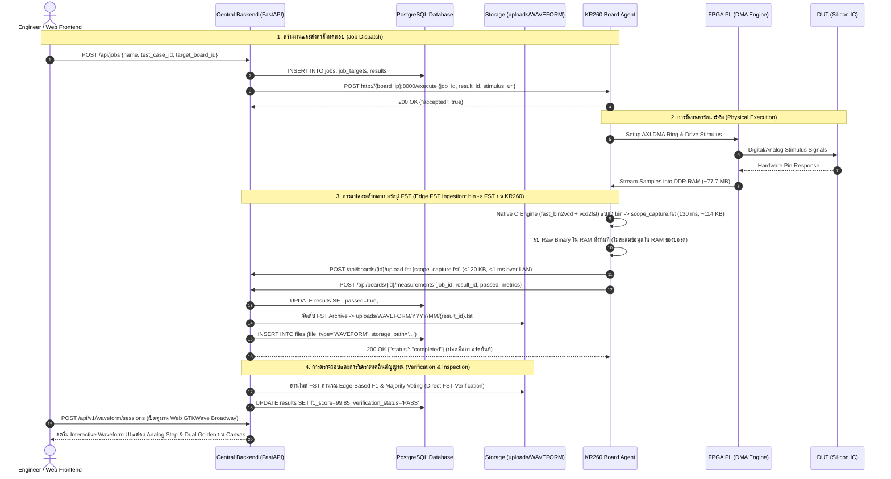

# System Job Sequence Diagram

> [!NOTE]
> เอกสารกระบวนการทำงานและ Sequence Diagram ฉบับเต็มได้รับการบันทึกและอ้างอิงไว้ที่:
> 📖 **[docs/architecture/JOB_SEQUENCE_DIAGRAM.md](../docs/architecture/JOB_SEQUENCE_DIAGRAM.md)**

