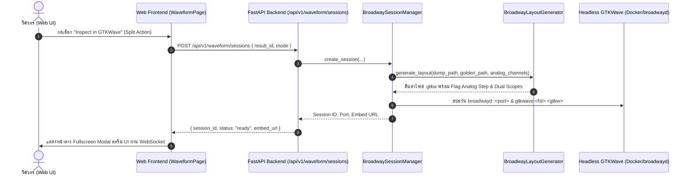

# คู่มือและสถาปัตยกรรม Embedded Web GTKWave (Broadway Inspection)

**รหัสเอกสาร:** `GUIDE-WAVEFORM-BROADWAY-01`  
**สถานะ:** Production / Active  
**อ้างอิงสถาปัตยกรรม:** [ADR 0004](../../docs/adr/0004-embedded-web-gtkwave-via-gdk-broadway.md), [ADR 0005](../../docs/adr/0005-analog-waveform-reconstruction-and-comparison-ux.md), [SPEC-0004](../../docs/specs/SPEC-0004-broadway-analog-waveform-inspection.md)

---

## 1. บทนำและภาพรวม (Overview)

ในการทดสอบและตรวจสอบความถูกต้องของชิป IC (DUT) ข้อมูลรูปคลื่นสัญญาณที่บันทึกผ่าน FPGA DMA จะถูกจัดเก็บเป็นไฟล์บีบอัดความเร็วสูง (`.fst`) บนเซิร์ฟเวอร์กลาง เพื่อให้วิศวกรสามารถวิเคราะห์รูปคลื่นสัญญาณเชิงลึก เช่น Bus Decoding, Transaction Markers, สัญญาณ Mixed-Signal (ADC/DAC), และการซูมดูระดับกิกะแซมเปิล ระบบจึงให้บริการ **GTKWave ผ่าน GDK Broadway HTML5 Backend**:

* **Zero Desktop Installation:** ใช้งานผ่าน Web Browser ได้ทันทีโดยไม่ต้องติดตั้งซอฟต์แวร์บนคอมพิวเตอร์ลูกข่าย
* **Muscle Memory Compatibility:** หน้าตา ปุ่มลัด เครื่องมือ และการลากวางเหมือน GTKWave ตัวเต็มทุกประการ
* **Memory Protection:** เรนเดอร์บนเซิร์ฟเวอร์แบบ headless แล้วส่งเฉพาะหน้าจอผ่าน WebSocket ป้องกันปัญหาเว็บเบราว์เซอร์ล่มจากไฟล์ขนาดหลายกิกะไบต์

---

## 2. การรองรับสัญญาณ Analog (Analog Signal Support)

GTKWave รองรับการแสดงผลสัญญาณ Analog แบบ Native:

### 2.1 สัญญาณ Multi-bit Digital Bus (ADC / DAC)
ข้อมูลตัวอย่างดิจิทัลหลายบิต (เช่น 8-bit, 10-bit, 12-bit, หรือ 16-bit จากพิน DUT) จะถูกแปลงเป็นรูปคลื่นแบบ **Analog Step (บันไดตัวอย่าง)** ผ่านตัวแปร Flag `@20020` ในไฟล์ `.gtkw`:
* **Zero-Order Hold:** ขั้นบันไดจะตรงตามจังหวะสัญญาณนาฬิกา (Sampling Clock) ของการแปลงสัญญาณจริง
* **Auto-Scaled Height:** ความสูงของแถวจะถูกขยายอัตโนมัติเป็น 64–80px เพื่อให้สังเกต Curve ได้ชัดเจนเหมือนหน้าจอออสซิลโลสโคป

### 2.2 การระบุพิน Analog (Deterministic Analog Pin Designation)
ระบบไม่ใช้การเดาสุ่มจากชื่อสัญญาณ แต่จะอ่านจากสเปกการต่อขาพิน (**Pin Map Spec**) ภายใน Test Case Configuration:

```json
{
  "comparator_config": {
    "analog_channels": [
      {
        "name": "ADC_OUT",
        "channels": ["CH0", "CH1", "CH2", "CH3", "CH4", "CH5", "CH6", "CH7"],
        "bit_width": 8,
        "format": "analog-step",
        "signed": false,
        "height": 72,
        "full_scale_min": 0.0,
        "full_scale_max": 3.3
      }
    ]
  }
}
```

---

## 3. สถาปัตยกรรมและกระบวนการส่งไฟล์เข้าสู่เซสชัน (File Ingestion Pipeline)



### การเปิดไฟล์และโหมดการเปรียบเทียบ (Dual-Mode Coexistence)
* **Inspect Actual Only:** โหลดเฉพาะไฟล์สัญญาณจริงที่จับได้จากชิป (`actual.*`)
* **Inspect Actual + Golden:** โหลดไฟล์แบบจำลอง Golden Simulation (`golden.*`) เข้ามาเปรียบเทียบคู่กับคลื่นจริงในหน้าต่างเดียวกันบนแกนเวลาที่ซิงโครไนซ์แล้ว

---

## 4. รายละเอียด REST API Endpoints

### 1. `POST /api/v1/waveform/sessions`
สร้างเซสชัน GTKWave Broadway ใหม่
* **Request Payload:**
  ```json
  {
    "result_id": "RES-2026-09-0012",
    "mode": "actual_only", // หรือ "dual_golden"
    "dump_path": "/storage/waveforms/capture.fst", // optional
    "golden_path": "/storage/waveforms/golden.vcd" // optional
  }
  ```
* **Response:**
  ```json
  {
    "session_id": "c1f7a28e-5b1d-4074-b7e1-881b7a2d1e55",
    "result_id": "RES-2026-09-0012",
    "port": 8085,
    "display_num": 5,
    "status": "ready",
    "embed_url": "/api/v1/waveform/sessions/c1f7a28e-5b1d-4074-b7e1-881b7a2d1e55/embed"
  }
  ```

### 2. `GET /api/v1/waveform/sessions/{session_id}/status`
ตรวจสอบสถานะและส่งสัญญาณ Heartbeat ต่ออายุเซสชัน

### 3. `DELETE /api/v1/waveform/sessions/{session_id}`
ส่งสัญญาณ `SIGTERM` ปิดโปรเซส GTKWave คืน Display Port เข้าสู่ Pool และลบไฟล์ Layout ชั่วคราว

### 4. `GET /api/v1/waveform/sessions/{session_id}/embed`
หน้าเพจ HTML สำหรับ Mount ใน iframe เพื่อสตรีม Canvas ผ่าน WebSocket

---

## 5. การจัดการทรัพยากรและความปลอดภัย (Resource & Watchdog Policy)

1. **Display Port Pool:** กำหนดช่วงพอร์ตอัตโนมัติ `:10` ถึง `:50` (แมปพอร์ต TCP 8085 ถึง 8120) ป้องกันการแย่งชิงพอร์ต
2. **Inactivity Watchdog:** หากไม่มีการเคลื่อนไหวหรือตัดการเชื่อมต่อเกิน **15 นาที** ระบบจะยุติเซสชันอัตโนมัติ เพื่อรักษา RAM ของเซิร์ฟเวอร์ (~30–50 MB ต่อเซสชัน)
3. **Container Sandboxing:** โปรเซส GTKWave และไฟล์ `.gtkw` ถูกจำกัดสิทธิ์ในโหมด headless ไม่สามารถเปิดไฟล์ข้ามเครื่องของผู้ใช้งานได้โดยตรง
